# Procesverslag
Markdown is een simpele manier om HTML te schrijven.  
Markdown cheat cheet: [Hulp bij het schrijven van Markdown](https://github.com/adam-p/markdown-here/wiki/Markdown-Cheatsheet).

Nb. De standaardstructuur en de spartaanse opmaak van de README.md zijn helemaal prima. Het gaat om de inhoud van je procesverslag. Besteedt de tijd voor pracht en praal aan je website.

Nb. Door *open* toe te voegen aan een *details* element kun je deze standaard open zetten. Fijn om dat steeds voor de relevante stuk(ken) te doen.

## Jij

  
uitwerken voor kick-off werkgroep

  ### Auteur:
  Callista Ramadwierta (500882786)

  #### Je startniveau:
  Rode piste

  #### Je focus:
  Responsive
 

## Je website

  
uitwerken voor kick-off werkgroep

  ### Je opdracht:
  COLLINS: https://wearecollins.com 

  #### Screenshot(s) van de eerste pagina (small screen): 
  COLLINS Home pagina

  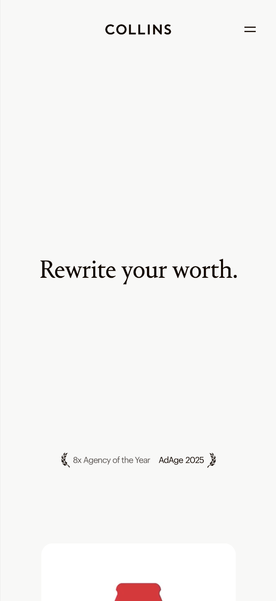
  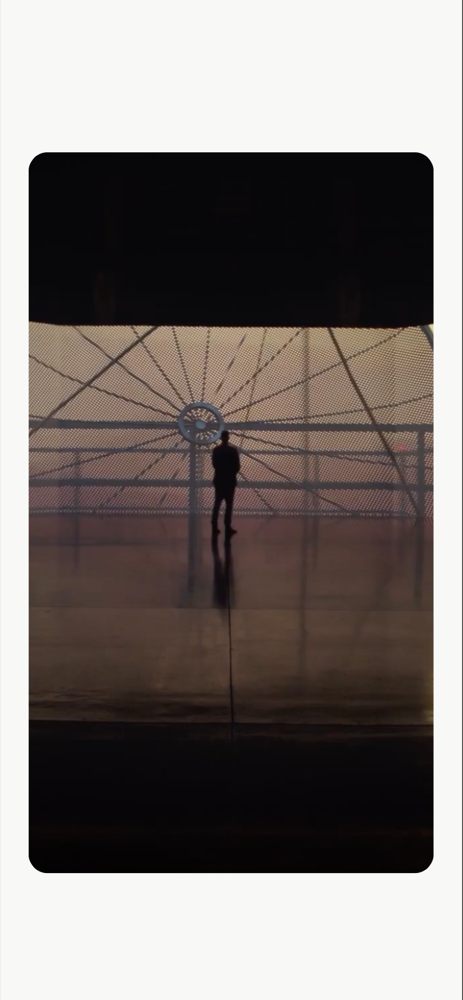 
  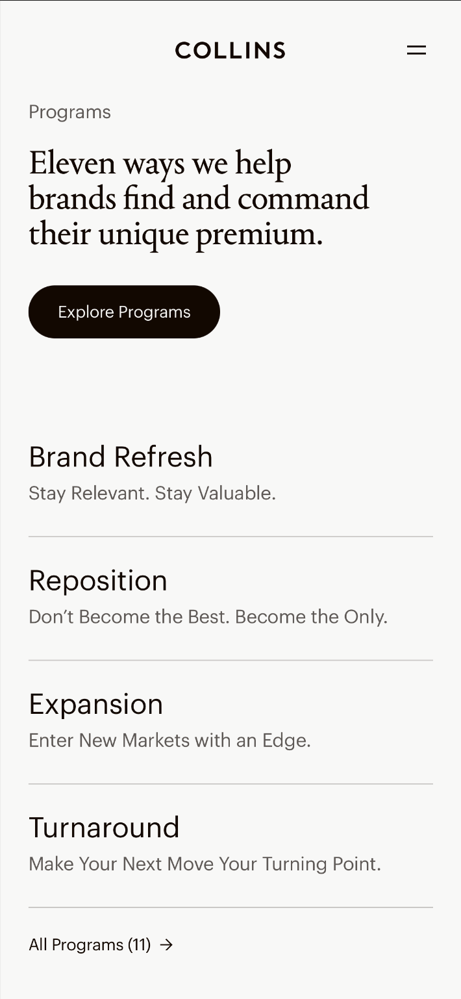
  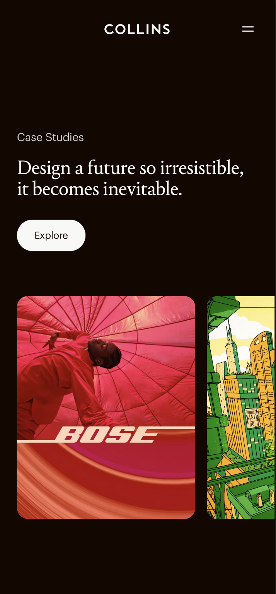
  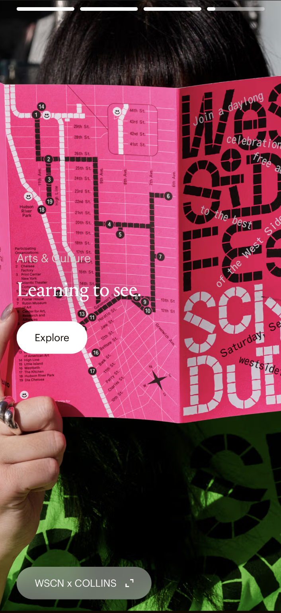
  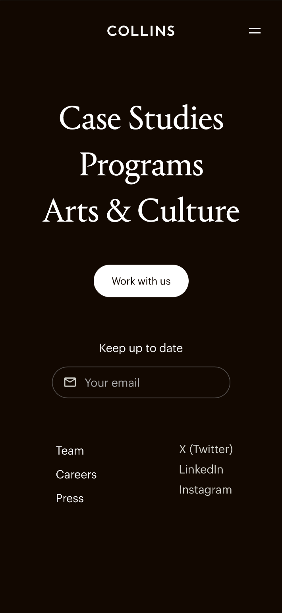 

  #### Screenshot(s) van de tweede pagina (small screen):
  COLLINS Arts & Culture pagina  

  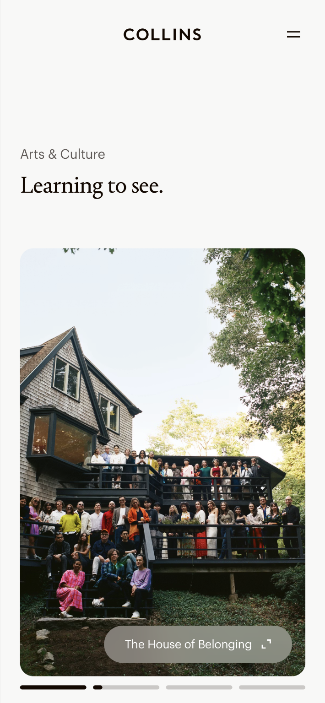
  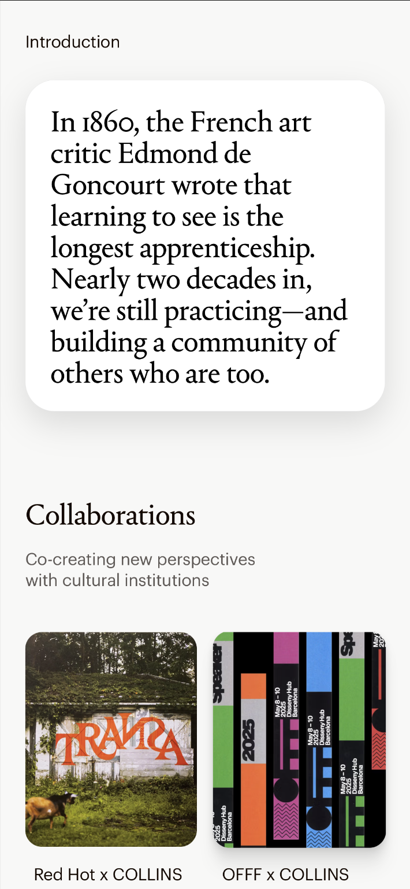
  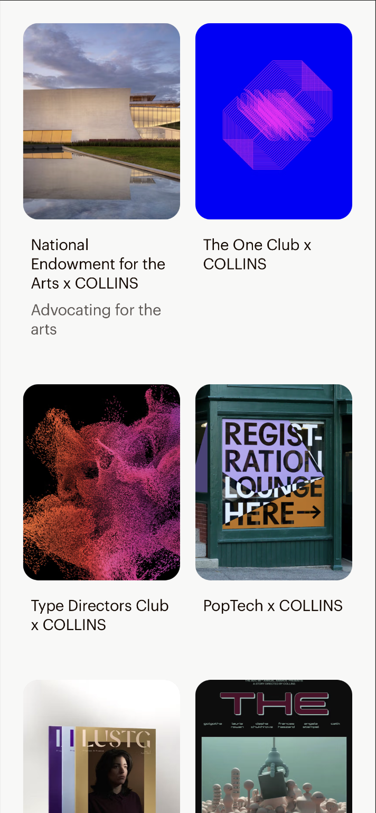
  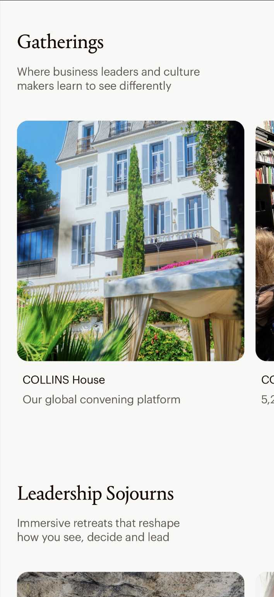
  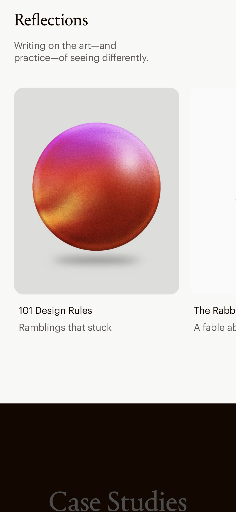
  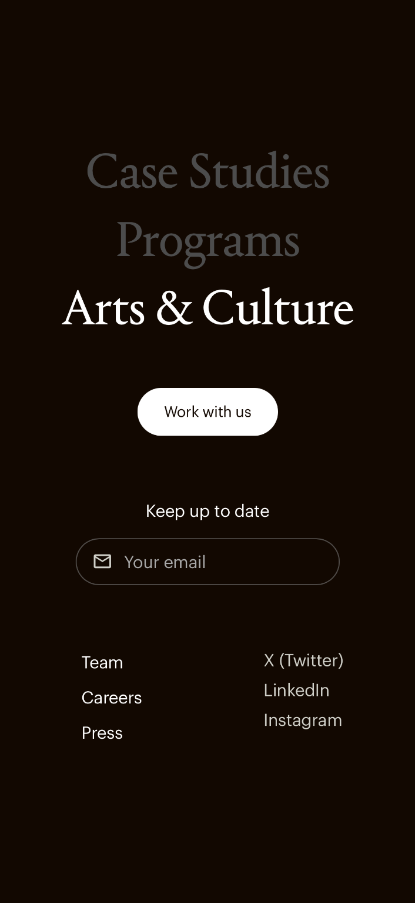
 

## Toegankelijkheidstest 1/2 (week 1)

  
uitwerken na test in 2e werkgroep

  ### Bevindingen
  Lijst met je bevindingen die in de test naar voren kwamen:

  - Met de Low contrast VisualEyes simulator, kwam naar voren dat teksten met dunne letterdiktes, bijna niet te zien zijn. De teksten verdwijnen dan mee met de achtergrond, waardoor het niet te lezen is. Verder heb je ook teksten op de voorgrond van een afbeelding. Die zijn alleen te zien met een dikkere letter dikte. Ook zijn buttons met een transparante achtergrond niet te zien als button op een afbeelding.

 -  Met de color (geel) VisualEyes simulator, waren er geen problemen te zien met het doorlopen van de website. Alleen een tekst met dunne letterdikte op een afbeelding, is weer niet te zien. Zonder simulators is het ook niet te zien, dus dat zou verbeterd kunnen worden.

 Met de screenreader:

 Is de structuur van de headings logisch?
- Met behulp van VoiceOver kon ik niet duidelijk weten waar de links eigenlijk naartoe gaan. Ik wist niet bij welke section ik was. Er zijn geen duidelijke headings gemaakt, om de structuur van de headings uberhaupt logisch te kunnen maken. Het zou fijn zijn om een duidelijke headings structuur te hebben voor de website.

 Geeft elke link goed aan wat en waar naartoe het gelinkt wordt?
- De VoiceOver leest de teksten van elke link goed voor, alleen is het niet duidelijk waar je naartoe wordt gestuurd. Dit komt ook omdat de headings niet vermelden bij welke section je bent. De linkjes hebben een meer decoratieve naam en functie, dan duidelijk de functie van een button of link.

WCAG Checklist 1/2:

  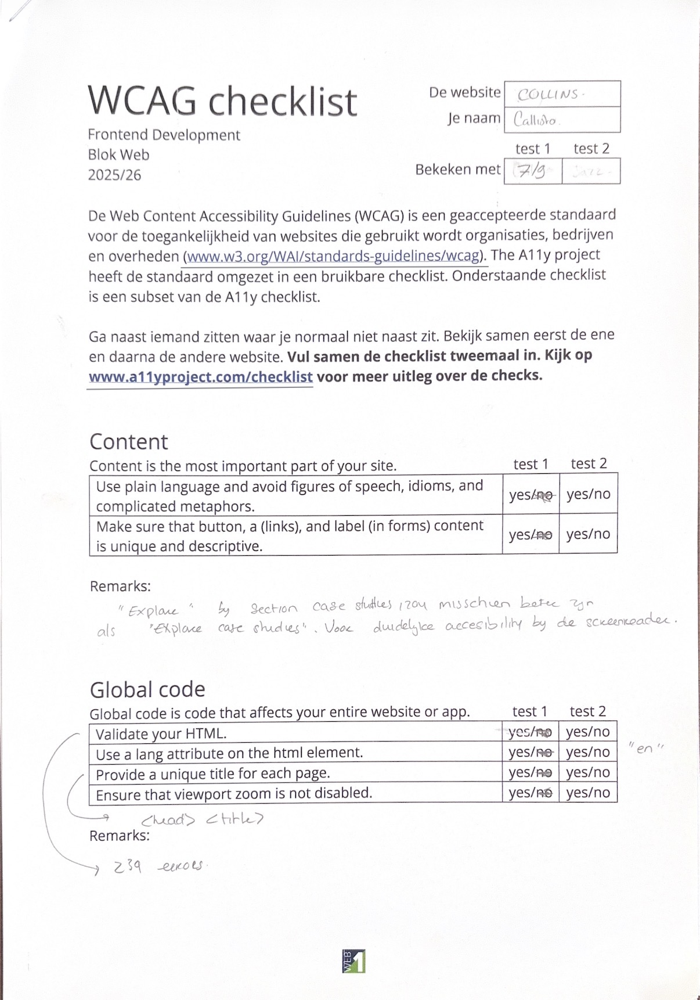

  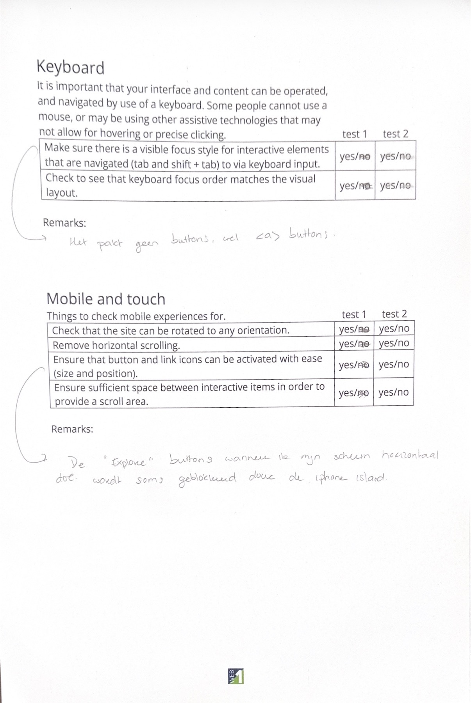

  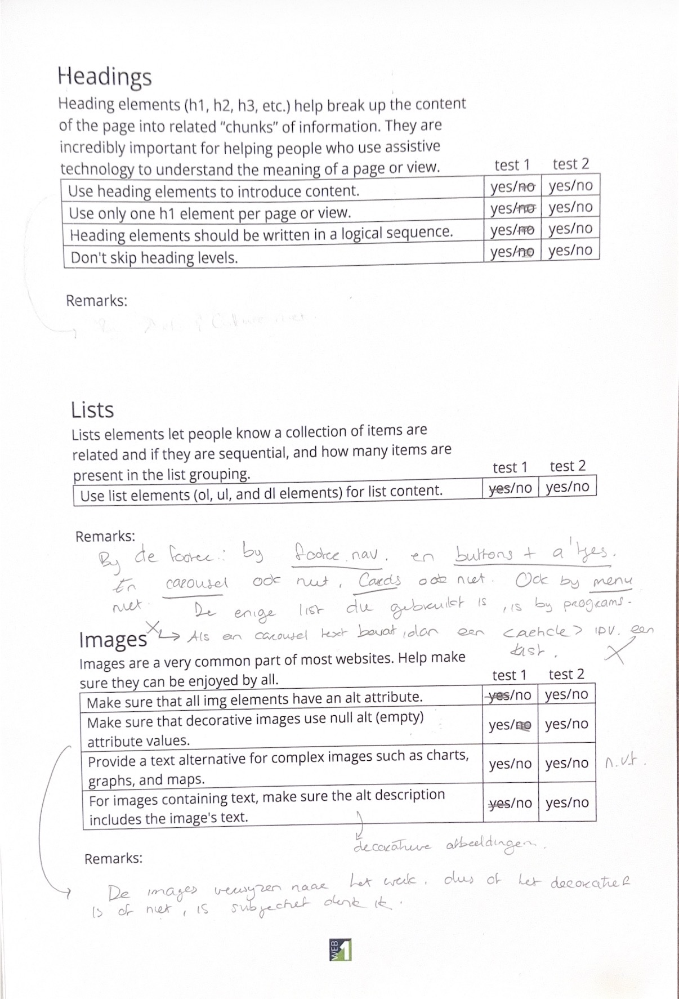

  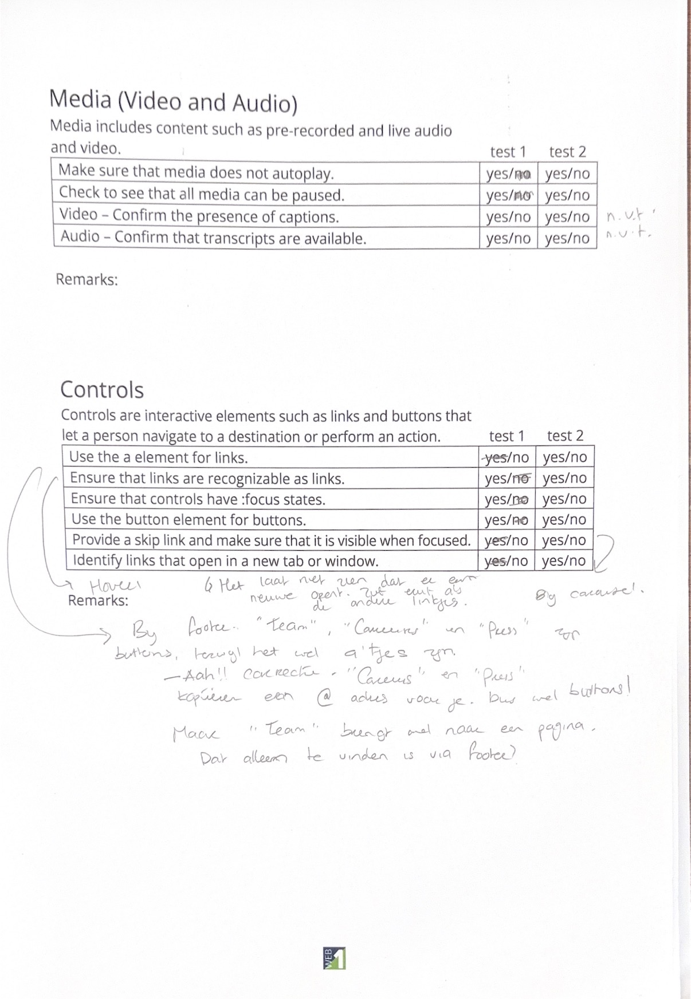

  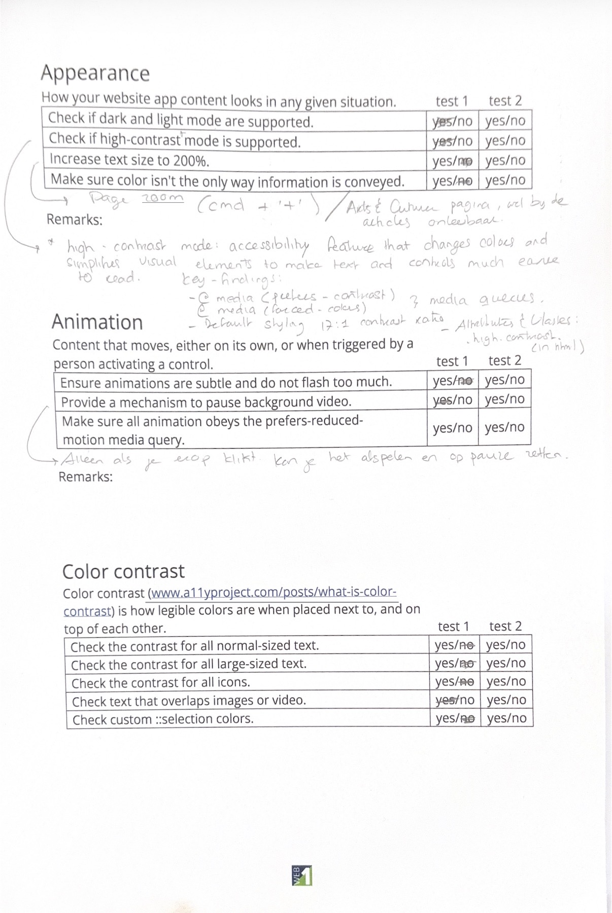

## Breakdownschets (week 1)

  
uitwerken na afloop 3e werkgroep

  Correctie!: in plaats van "body" in de afbeeldingen van de breakdownschets, hoort "main" te staan.

  Vraag: 
  - bij de article.programs.list ,  zit er in de a dan ook nog een h3 en p?

  ### de hele pagina: 
  

  ### dynamisch deel (bijv menu): 
  

  ### Arts & Culture pagina: 
  

## Voortgang 1 (week 2)

  
uitwerken voor 1e voortgang

  ### Stand van zaken
  hier dit ging goed & dit was lastig (neem ook screenshots op van delen van je website en code)

    Vraag: 
  - WAT IS DEZE LINK BOVEN VOOR?
  - bij de article.programs.list ,  zit er in de a dan ook nog een h3 en p? // het is een h3
  - HOE ZET IK DE EMAIL ICOON SVG IN DE INPUT TYPE EMAIL?
  - HOE KRIJG IK DE TEKST "YOUR EMAIL" IN DE INPUT?

  ### Agenda voor meeting
  samen met je groepje opstellen

  | student 1      | student 2          | student 3    | student 4        |
  | ---            | ---                | ---          | ---              |
  | dit bespreken  | en dit             | en ik dit    | en dan ik dat    |
  | en dat ook nog | dit als er tijd is | nog een punt | dit wil ik zeker |
  | ...            | ...                | ...          | ...              |

  student 1:
  - wat is de html voor deze tekst bubbels? // 
  - wat is deze button die niet naar een ander pagina linkt maar alleen opnieuw grapjes op de pagina zet? // dialogue

  student 2:
  - mag je een div gebruiken? // nee

  student 3:
  - 

  ### Verslag van meeting
  hier na afloop snel de uitkomsten van de meeting vastleggen

  Feedback van andere studenten:
  - above the fold: alles is dan de header, alles dat je als eerst ziet als je de pagina opent, header is vaak meer dan alleen de nav, en als je dan scrolt begint je main.
  - een article is dus 1 card, stel je hebt 3 cards, heb je ook 3 losse articles.
  - uitklap dingetjes in html heet “details” ipv ul
  
  Mijn feedback:
  - svg'tjes kan je downloaden in de html van de developer tool, en zet je in een nieuwe file in vscode (zie hamburger.svg)
  - video kan je downloaden in de html ook
  - in de head kan je de svg ook veranderen, maar geen prioriteit, wel leuk.
  - je gebruikt OF een article OF een ul, niet beide tegerlijkertijd.
  - ALTIJD een h1,h2,h3 in een article gebruiken.
  - elke card is een article, daaromheen hoeft niet WEER een section. dat heb je al gedaan.
  - bij je footer, dat hoeft geen article te zijn, dat is gewoon een ul. 

  Vraag en antwoord:
    - WAT IS DEZE LINK BOVEN VOOR?
    // is een svg als html, voor nu geen prioriteit voor je icon pagina van je web.
  - bij de article.programs.list ,  zit er in de a dan ook nog een h3 en p? 
  // het is een h3
  - HOE ZET IK DE EMAIL ICOON SVG IN DE INPUT TYPE EMAIL?
  // in css https://developer.mozilla.org/en-US/docs/Web/CSS/Reference/Selectors/::before . dit is de link voor hoe je dat doet in je css. je gebruikt dan een "::before"
  - HOE KRIJG IK DE TEKST "YOUR EMAIL" IN DE INPUT?
  // <//input placeholder="Your email" type="email">. een placeholder zetten in je input.

## Voortgang 2 (week 3)

  
uitwerken voor 2e voortgang

  ### Stand van zaken
  hier dit ging goed & dit was lastig (neem ook screenshots op van delen van je website en code)

  Vraag & Opmerkingen:
  - Voor de hero video op de homepagina, lukt het niet om de video te downloaden. Vandaar dat ik het heb gekopieerd en plak in mijn eigen code. Is dit oke?

    // als het werkt is het prima! :P

  - Je ziet mijn arrow svg'tjes niet waardoor komt dat?

    // handig om te doen is ze in figma te zetten en daar het zwart maken.

  - Ik heb de fonts van mijn website geconvert van otf naar woff. Alleen kan ik deze niet openen op mijn laptop. Het staat nog steeds in een folder van de basiswebsite-4. Ook heb ik de CSS code gekopieeërd en geplakt in CSS. Dus heb ik het perongeluk op 2 manieren gedaan, en kan er een weg gelaten worden?

    // code in css is al goed en prima.

  - Alle sections moet ik nog verwijderen, dit maakt het voor mij nu overzichtelijk.
  - Ik heb alle h2 en p omgewisseld, zodat in CSS is alle p'tjes de font: Graphik en alle h2'tjes de font: Portrait text. Semantisch is dit correct, maar klopt dat dan ook met de structuur voor de toeganelijkheid? Wanneer het wel overduidelijk een p is heb ik een class gemaakt als .portrait-text. Dit zit in de arts & culture pagina, zodat ik bij deze enige als onderscheid kan maken.

    // maakt niet uit, screenreader leest sws per sectie. dus alleen als je je h1,h2,h3 door elkaar is, is het niet handig voor de toegankelijkheid.

  - Als aantekening voor mezelf om in CSS te zetten, de a in de header nav en footer nav zijn allebei in de font: Portrait-Text
  - Heb ik mijn fonts correct in CSS gezet? Het pakt de font Portrait-Text niet, maar misschien komt die fout tijdens het downloaden. Ik denk dat het ligt aan de woff format die niet wordt gedownload op mijn laptop dus het pakt alleen de serif en sans-serif op.

    // kijk naar of je naar de juiste folder refereert!

  - Wat is het verschil tussen rem en em?

    // rem is root em, het pakt standaard 16px. 1 rem is 16px. blijft dus altijd 16px. als je em werkt, rekent het met de font size dat al in de hele document staat, stnadaard is 16, maar kan ook 21 px aangeapst zijn. rem is wel handiger want altijd 16 px. persoonlijke voorkeur.

  ### Agenda voor meeting
  samen met je groepje opstellen

  | student 1      | student 2          | student 3    | student 4        |
  | ---            | ---                | ---          | ---              |
  | dit bespreken  | en dit             | en ik dit    | en dan ik dat    |
  | en dat ook nog | dit als er tijd is | nog een punt | dit wil ik zeker |
  | ...            | ...                | ...          | ...              |

  

  ### Verslag van meeting
  hier na afloop snel de uitkomsten van de meeting vastleggen

  - svg in figma laden.
  - rem is root em, het pakt standaard 16px. 1 rem is 16px. blijft dus altijd 16px. als je em werkt, rekent het met de font size dat al in de hele document staat, stnadaard is 16, maar kan ook 21 px aangeapst zijn. rem is wel handiger want altijd 16 px. persoonlijke voorkeur. 
  - en voor de volgorde hoe je daarna verder wil werken is prima, schalen doe je in CSS. Begin altijd met mobiel en daarna steeds groter en dan zie je hoeveel er dan nu passen op het scherm.
  - voor de hamburger menu, mijn website is full screen. dus maak sws eerst de opdrachten en verder is het en blijft het een hamburger menu, en als je het open klapt, vult het de hele scherm. 
  
  van andere stundete:
  - je kan meerdere stylesheet hebben, als de structuur maar blijft. dus css voor header, footer en html apart.
  

## Toegankelijkheidstest 2/2 (week 4)

  
uitwerken na test in 9e werkgroep

  ### Bevindingen
  Lijst met je bevindingen die in de test naar voren kwamen (geef ook aan wat er verbeterd is):

## Voortgang 3 (week 4)

  
uitwerken voor 3e voortgang

  ### Stand van zaken
  hier dit ging goed & dit was lastig (neem ook screenshots op van delen van je website en code)

  ### Agenda voor meeting
  samen met je groepje opstellen

  | student 1      | student 2          | student 3    | student 4        |
  | ---            | ---                | ---          | ---              |
  | dit bespreken  | en dit             | en ik dit    | en dan ik dat    |
  | en dat ook nog | dit als er tijd is | nog een punt | dit wil ik zeker |
  | ...            | ...                | ...          | ...              |

  ### Verslag van meeting
  hier na afloop snel de uitkomsten van de meeting vastleggen

  - punt 1
  - punt 2
  - nog een punt
  - ...

## Eindgesprek (week 5)

  
uitwerken voor eindgesprek

  ### Je uitkomst - karakteristiek screenshots:
  

  ### Dit ging goed/Heb ik geleerd: 
  Korte omschrijving met plaatjes

  

  ### Dit was lastig/Is niet gelukt:
  Korte omschrijving met plaatjes

  

## Bronnenlijst

  
continu bijhouden terwijl je werkt

  Nb. Wees specifiek ('css-tricks' als bron is bijv. niet specifiek genoeg). 
  Nb. ChatGpT en andere AI horen er ook bij.
  Nb. Vermeld de bronnen ook in je code.

 1. MDN Web Docs. (z.d.). <svg>: The SVG element. Geraadpleegd op 30 september 2026.
 2. MDN Web Docs. (z.d.). : The Image Embed element. Geraadpleegd op 30 september 2026.
 3. MDN Web Docs. (z.d.). CSS width property. Geraadpleegd op 30 september 2026.
 4. MDN Web Docs. (z.d.). Stroke. Geraadpleegd op 30 september 2026.
 5. Font Converter (z.d). Convert a font file. Geraadpleegd op 30 september 2026.
 6. MDN Web Docs. (z.d). Display. Geraadpleegd op 30 september 2026.
 7. DLO Mijn HvA. (z.d). Werkgroep 5: Dé JS 3-Stap. Hamburger menu. Responsive fixed-button burger. Geraadpleegd op 30 september 2026.
 8. MDN Web Docs. (z.d). ::before CSS Pseudo-element. Geraadpleegd op 13 october 2026.
 9. MDN Web Docs. (z.d). background-*. Geraadpleegd op 13 october 2026.
 10. ChatGPT. (z.d). margin-inline. Geraadpleegd op 5 november 2026.
 

